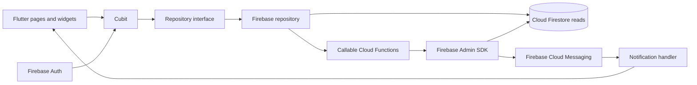
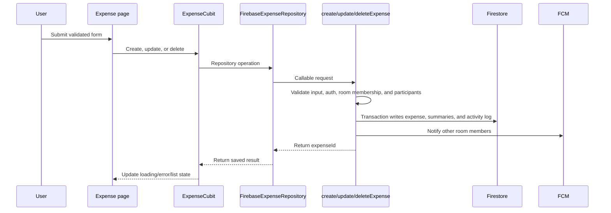

# PocketTogether

> Shared expenses, simplified. Manage room spending, track contributions, and stay in sync with everyone.
> 

https://github.com/user-attachments/assets/87622962-19a4-444b-a7a0-e4398d6eda3f


[](https://flutter.dev/)
[](https://dart.dev/)
[](https://firebase.google.com/)
[](https://www.typescriptlang.org/)

PocketTogether is a Flutter mobile app for recording and reviewing shared expenses in collaborative rooms. Firebase Authentication identifies users, Cloud Firestore stores room and expense data, and callable Cloud Functions enforce trusted mutations and maintain derived totals.

**Status:** Active development. There is no declared license or hosted demo in this repository.

## Contents

- [Overview](#overview)
- [Features](#features)
- [Screenshots](#screenshots)
- [Technology stack](#technology-stack)
- [Architecture](#architecture)
- [Project structure](#project-structure)
- [Firestore data model](#firestore-data-model)
- [Callable Functions](#callable-functions)
- [Security design](#security-design)
- [Getting started](#getting-started)
- [Firebase emulators](#firebase-emulators)
- [Development workflow](#development-workflow)
- [Testing](#testing)
- [Engineering decisions](#engineering-decisions)
- [Limitations and roadmap](#limitations-and-roadmap)
- [Contributing](#contributing)
- [License](#license)

## Overview

A user signs in, creates or joins a room with an invite code, and sees the rooms where their user ID is a member. Room members can record expenses with a payer, category, date, note, and exact integer-cent splits. The room dashboard, history view, statistics view, member list, and activity timeline provide different ways to understand the shared ledger.

Room creation, membership changes, expense mutations, activity records, summary counters, and push notification delivery are coordinated by Firebase Cloud Functions. The Flutter client reads permitted Firestore data and calls the backend for operations that change shared state.

## Features

### Authentication and profiles

- Email/password registration and login.
- Google sign-in through Firebase Authentication.
- Persistent Firebase Auth sessions.
- Password reset email flow.
- A Firestore profile under `users/{userId}` with display name and email.
- Profile creation after registration and profile recovery when an authenticated session has no profile document.

### Room management

- Create a room with a name and three-letter currency code.
- Receive an eight-character invite code when creating a room.
- Generate another invite as the room owner.
- Join a room with a one-day invite code; repeated joins are handled as `already-member`.
- View room members and owner/member roles.
- Remove a member as the owner. The owner cannot remove themself.
- Delete a room as the owner, including its members, expenses, activity logs, and room invites.
- Stream the signed-in user's rooms using a Firestore `array-contains` membership query.

### Expenses

- Create, edit, and delete expenses.
- Record who paid and who created the expense.
- Categorize expenses and optionally add notes.
- Record transfer method and recipient for transfer expenses.
- Split an expense across room members using exact integer cents.
- Review an expense history with search, category, member, and month filtering.

### Statistics and activity

- Room all-time and monthly totals.
- Payer all-time and monthly totals.
- Spending-by-category and spending-by-member charts in the statistics view.
- Cursor-paginated activity timeline with `all`, `expenses`, and `members` filters.
- Supported activity events include room creation, expense creation/update/deletion, member joining, and member removal.

### Notifications

Firebase Cloud Messaging is implemented for expense-created, expense-updated, and member-joined notifications.

- Device tokens are stored under the signed-in user's `fcmTokens` subcollection and removed when invalid or when the user changes.
- Foreground messages are shown as an in-app snackbar.
- Tapping a notification opens the rooms screen; expense notifications select the history tab.
- Background message handling initializes Firebase. The repository does not implement a separate local notification UI for background messages.

## Screenshots

The repository does not currently include screenshots. These paths are placeholders for future captures:

| Screen | Suggested path |
| --- | --- |
| Authentication | `docs/images/authentication.png` |
| Rooms home | `docs/images/rooms-home.png` |
| Room details | `docs/images/room-details.png` |
| Add expense | `docs/images/add-expense.png` |
| Expense history | `docs/images/history.png` |
| Statistics | `docs/images/statistics.png` |
| Members | `docs/images/members.png` |
| Activity timeline | `docs/images/activity.png` |

Add real images to `docs/images/` and update this table when screenshots are available. Do not commit credentials or personal data in screenshots.

## Technology stack

### Mobile application

- **Flutter and Dart:** cross-platform UI and application runtime. The SDK constraint is Dart `^3.13.5`.
- **flutter_bloc / Cubit:** feature state, loading states, mutation progress, and error presentation.
- **go_router:** authentication-aware routing for login, registration, password reset, and rooms.
- **json_annotation / json_serializable:** model serialization for rooms, members, expenses, and statistics.
- **fl_chart:** statistics charts.
- **timelines_plus:** activity timeline presentation.

### Backend and services

- **Firebase Authentication:** email/password and Google identity providers.
- **Cloud Firestore:** profiles, rooms, membership snapshots, expenses, summaries, activity logs, invites, and FCM tokens.
- **Cloud Functions for Firebase:** TypeScript callable API for authorized room and expense mutations.
- **Firebase Cloud Messaging:** token registration and room-member notifications.
- **Firebase Admin SDK:** privileged server-side Firestore, Auth, and Messaging access.

### Development tools

- Flutter SDK and Dart tooling.
- Node.js `22` for `functions/`.
- npm for Cloud Functions dependencies and scripts.
- Firebase CLI and Firebase Emulator Suite.
- Flutter analyzer, Flutter tests, TypeScript compiler, and Node's built-in test runner.

## Architecture

The Flutter code follows a feature-based structure with Cubits coordinating UI state, repositories defining data operations, and Firebase adapters implementing those repositories. Shared writes to rooms and expenses cross the callable Functions boundary; read models use Firestore directly where rules permit.



Authentication is initialized before the router. The router redirects signed-out users to `/login` and authenticated users away from the auth routes. `AuthCubit` combines Firebase Auth state with profile validation, while `PocketTogetherApp` constructs the default Firebase repositories or accepts test doubles through constructor injection.

### Expense mutation flow



Expense transactions update the source expense, four summary destinations, and the activity log together. Notification delivery occurs after the data transaction and is treated as a separate best-effort side effect.

## Project structure

```text
.
├── lib/
│   ├── main.dart
│   ├── firebase_options.dart
│   ├── app/
│   │   ├── app.dart
│   │   └── theme/
│   ├── core/
│   │   └── notifications/
│   ├── features/
│   │   ├── auth/
│   │   ├── expenses/
│   │   ├── profile/
│   │   ├── rooms/
│   │   └── statistics/
│   └── shared/
├── test/
│   ├── features/
│   └── support/
├── functions/
│   ├── src/
│   │   ├── expenses/
│   │   ├── index.ts
│   │   ├── notifications.ts
│   │   └── rooms.ts
│   ├── test/
│   ├── package.json
│   └── tsconfig.json
├── android/
├── assets/icon/logo.png
├── firebase.json
├── firestore.rules
├── firestore.indexes.json
├── pubspec.yaml
└── analysis_options.yaml
```

Important boundaries:

- `lib/features/*/data/` contains repository contracts and Firebase adapters.
- `lib/features/*/presentation/cubit/` owns feature state and asynchronous actions.
- `lib/features/*/models/` contains Firestore-facing and UI-facing models.
- `lib/core/notifications/` handles FCM token lifecycle, message parsing, and navigation callbacks.
- `functions/src/rooms.ts` implements room and membership callables.
- `functions/src/expenses/` separates callable controllers, schema validation, persistence, and summary calculations.
- `test/support/test_app.dart` provides fake repositories for Flutter widget tests.

## Firestore data model

### Collections

| Path | Purpose | Client access |
| --- | --- | --- |
| `users/{userId}` | User profile with display name and email | The owner can read/create/update their own profile. Deletes are disabled. |
| `users/{userId}/fcmTokens/{tokenId}` | FCM registration token, platform, and timestamps | The owner can create/update/read/delete their own tokens. |
| `rooms/{roomId}` | Room name, currency, owner IDs, timestamps, and `memberIds` | Room members can read. Direct client writes are denied. |
| `rooms/{roomId}/members/{userId}` | Membership snapshot with role and `joinedAt` | Room members can read. Writes are server-only. |
| `rooms/{roomId}/expenses/{expenseId}` | Expense source records | Room members can read. Writes are server-only. |
| `rooms/{roomId}/stats/summary` | All-time room total | Room members can read. Writes are server-only. |
| `rooms/{roomId}/monthlyStats/{yyyy-MM}` | Monthly room total | Room members can read. Writes are server-only. |
| `rooms/{roomId}/members/{userId}/stats/summary` | All-time amount paid by a member | Room members can read. Writes are server-only. |
| `rooms/{roomId}/members/{userId}/monthlyStats/{yyyy-MM}` | Monthly amount paid by a member | Room members can read. Writes are server-only. |
| `rooms/{roomId}/activityLogs/{activityId}` | Append-only room timeline events | Room members can read. Writes are server-only. |
| `roomInvites/{inviteCode}` | Server-managed invite metadata | Direct client reads and writes are denied. |

Representative room document:

```json
{
	"name": "Weekend in Penang",
	"createdBy": "owner-uid",
	"ownerId": "owner-uid",
	"currency": "MYR",
	"memberIds": ["owner-uid", "member-uid"],
	"createdAt": "Firestore Timestamp",
	"updatedAt": "Firestore Timestamp"
}
```

Representative expense document:

```json
{
	"amountInCents": 1001,
	"category": "Food",
	"note": "Shared lunch",
	"paidByUserId": "owner-uid",
	"createdByUserId": "owner-uid",
	"splitAmountsInCents": {
		"owner-uid": 501,
		"member-uid": 500
	},
	"expenseDate": "Firestore Timestamp",
	"createdAt": "Firestore Timestamp",
	"updatedAt": "Firestore Timestamp"
}
```

`paidByUserId` identifies the member who paid. `createdByUserId` identifies the user who created the record and cannot be changed during an update. `expenseDate` controls history ordering and the UTC month used for summaries; `createdAt` and `updatedAt` describe record lifecycle. Amounts and splits are integer cents so validation does not depend on floating-point rounding, and split values must sum exactly to `amountInCents`.

### Summary maintenance

For each expense, the backend applies the amount to these four destinations using `FieldValue.increment` inside the same transaction as the mutation:

```text
rooms/{roomId}/stats/summary.totalExpenseInCents
rooms/{roomId}/monthlyStats/{yyyy-MM}.totalExpenseInCents
rooms/{roomId}/members/{paidByUserId}/stats/summary.totalPaidInCents
rooms/{roomId}/members/{paidByUserId}/monthlyStats/{yyyy-MM}.totalPaidInCents
```

The month ID is UTC `yyyy-MM` derived from `expenseDate`. Missing summary documents are read as zero by `FirebaseExpenseStatisticsRepository`. The admin-only `rebuildExpenseSummaries` callable deletes existing summary documents and recomputes them from source expenses in bounded batches.

### Activity records

Activity records contain `type`, `actorUserId`, `targetType`, `targetId`, `createdAt`, and optional metadata. Expense records may include amount and title metadata; membership records may include member identity metadata. The client reads them in descending `createdAt` and ascending document ID order, fetching one extra record to determine whether another page exists. Composite indexes for these queries are declared in `firestore.indexes.json`.

## Callable Functions

All callables are deployed in `us-central1` and require Firebase Auth unless noted otherwise.

| Function | Request | Response | Authorization and side effects |
| --- | --- | --- | --- |
| `createRoom` | `{ name, currency? }` | `{ roomId, inviteCode, expiresAt }` | Any signed-in user. Validates a 1-80 character name, defaults invalid currency to `MYR`, and creates the room, owner membership, `room_created` activity, and one-day invite in a transaction. |
| `createRoomInvite` | `{ roomId }` | `{ inviteCode, expiresAt }` | Room owner only. Creates an active one-day invite. |
| `joinRoom` | `{ inviteCode, eventId? }` | `{ roomId, status: "joined" \| "already-member" }` | Signed-in user with a valid active, unexpired invite. Adds membership and a `member_joined` activity when needed, then notifies other members. |
| `getRoomMembers` | `{ roomId }` | Array of `{ userId, displayName, role, joinedAt }` | Room members only. Reads membership documents and profile names through the Admin SDK. |
| `removeRoomMember` | `{ roomId, memberId, eventId? }` | `{ roomId, memberId }` | Room owner only; the owner cannot remove themself. Deletes membership, removes the ID from `memberIds`, and logs `member_removed`. |
| `deleteRoom` | `{ roomId }` | `{ roomId }` | Room owner only. Deletes room members, expenses, activity logs, related invites, and the room document in bounded batches. |
| `createExpense` | Full expense input including `roomId`, `expenseId`, `amountInCents`, `category`, payer, creator, splits, and `expenseDate` | `{ expenseId }` | Signed-in room member. Validates exact positive integer cents, participant membership, and creator identity; writes the expense, summaries, activity, and notifications. Repeating the same ID and payload is safe. |
| `updateExpense` | Same expense input, including an existing `expenseId` | `{ expenseId }` | Signed-in room member. Reverses the old summary contribution, applies the new one, preserves `createdAt`, and logs `expense_updated`. |
| `deleteExpense` | `{ roomId, expenseId }` | `{ expenseId }` | Signed-in room member. Deletes the expense, reverses summary contributions, and logs `expense_deleted`. |
| `rebuildExpenseSummaries` | `{ roomId }` | `{ roomId, expenseCount }` | Signed-in user with the Auth custom claim `admin: true`. Rebuilds all room and member summary documents from source expenses. |

Callable validation errors use Firebase `HttpsError` codes such as `unauthenticated`, `invalid-argument`, `not-found`, `permission-denied`, `failed-precondition`, `deadline-exceeded`, and `already-exists`.

## Security design

- Firebase Authentication supplies the user identity used by both the app and callable Functions.
- Firestore rules allow signed-in users to read only rooms whose `memberIds` contain their UID.
- Room members can read members, expenses, summaries, and activity logs, but direct client writes to those collections are denied.
- FCM token writes are restricted to the authenticated owner and require string `token` and `platform` fields.
- Cloud Functions repeat membership and owner checks with the Admin SDK because Admin SDK writes bypass Firestore Security Rules.
- Expense callables validate the room member making the request, every payer/split participant, positive safe integer amounts, and exact split totals.
- Client-side form validation improves UX but is not the security boundary.
- Activity records and summary documents are server-managed. FCM delivery is best effort and does not replace the activity log.

This repository contains security rules and backend checks, but it does not claim a complete production security review. Firebase provider configuration, IAM, App Check, operational monitoring, and deployment controls must be reviewed for the target project.

## Getting started

### Prerequisites

- Flutter SDK compatible with Dart `3.13.5` or later within the declared SDK range.
- Node.js `22` and npm.
- Firebase CLI.
- An Android development environment for the checked-in Android target.
- A Firebase project with Auth, Firestore, Functions, and FCM configured.

### Install dependencies

From the repository root:

```powershell
flutter pub get
Push-Location functions
npm install
Pop-Location
```

Generated JSON serialization files are checked into the repository. When changing annotated models, regenerate them with:

```powershell
dart run build_runner build --delete-conflicting-outputs
```

### Firebase project setup

The checked-in Flutter configuration targets the Firebase project ID `ffta-85df5` and the Android app configuration in `android/app/google-services.json`. For another project, configure FlutterFire for the intended platforms and replace the generated configuration files; do not commit private credentials.

In the Firebase console:

1. Select or create the target project.
2. Enable Email/Password and Google sign-in providers.
3. Create a Firestore database.
4. Configure Cloud Messaging for the target mobile application.
5. Review and deploy `firestore.rules` and `firestore.indexes.json`.
6. Deploy the Functions source after reviewing the target project.

Deploy backend configuration from the repository root:

```powershell
firebase deploy --only functions,firestore:rules,firestore:indexes
```

No `.env` file or application-specific environment variable is used by the checked-in code. `firebase_options.dart` and the Android Google services file contain Firebase client configuration, not server secrets. Keep service-account keys and other administrative credentials outside the repository.

### Run the app

```powershell
flutter run
```

The app starts at `/login` for signed-out users and `/rooms` for authenticated users. Routes currently defined are `/login`, `/register`, `/forgot-password`, and `/rooms`; the rooms route accepts `?tab=history` for notification navigation.

## Firebase emulators

`firebase.json` configures these emulators:

| Emulator | Port |
| --- | ---: |
| Authentication | 9099 |
| Firestore | 8080 |
| Functions | 5001 |
| Emulator UI | 4000 |

Start them from the repository root:

```powershell
firebase emulators:start
```

Run the Android app against the host emulators:

```powershell
flutter run --dart-define=USE_FIREBASE_EMULATORS=true
```

When that flag is enabled, `lib/main.dart` connects Android to `10.0.2.2` for Auth, Firestore, and Functions. The repository does not include a seed-data script or emulator integration test suite. FCM delivery requires real Firebase Messaging infrastructure and is not provided by the configured emulator set.

The Functions package also provides:

```powershell
Push-Location functions
npm run serve
Pop-Location
```

That script builds TypeScript and starts the Auth, Firestore, and Functions emulators.

## Development workflow

1. Put user-facing state transitions in the relevant Cubit and keep Firebase details behind a repository interface.
2. Add or update a model in the feature's `models/` directory, including safe parsing for untrusted Firestore data.
3. Add repository methods to the interface and Firebase adapter. Use callable Functions for trusted shared-state mutations.
4. Add schema validation, authorization, transaction writes, summary updates, and activity logging in `functions/src/` as applicable.
5. Update `firestore.rules` and `firestore.indexes.json` whenever a data access path changes.
6. Add a focused Flutter widget/unit test or Functions test for the behavior.
7. Format and run checks before opening a pull request.

Useful commands:

```powershell
dart format lib test
flutter analyze
flutter test
Push-Location functions
npm run build
npm test
Pop-Location
```

## Testing

The repository contains Flutter widget and unit tests under `test/`, including authentication flow, room flow, expense flow, room ledger aggregation, model parsing, and activity pagination. Tests use fake repositories and do not require Firebase emulators.

The Functions tests under `functions/test/` compile the TypeScript first and use Node's built-in test runner. They cover callable authentication and argument validation, room validation, expense schema validation, and UTC summary target calculation. They are not a full Firestore emulator integration suite.

Run the available suites with:

```powershell
flutter test
Push-Location functions
npm test
Pop-Location
```

There is no checked-in end-to-end mobile test suite, no emulator seed script, and no notification delivery integration coverage. `functions/src/notifications.ts` also records a TODO for emulator/integration coverage of token selection and send retries.

## Engineering decisions

| Decision | Rationale and trade-off |
| --- | --- |
| Feature-based Flutter structure | Keeps auth, rooms, expenses, profile, and statistics code close to its UI, models, and data adapters. Cross-feature flows such as the room ledger still require explicit dependencies. |
| Cubit plus repositories | Cubits own presentation state while repositories make Firebase access replaceable in tests. This adds interfaces and wiring but keeps widgets from owning backend operations. |
| Callable Functions for mutations | Shared writes need authoritative membership, owner, validation, summary, and activity handling. Admin SDK access requires duplicated authorization checks because it bypasses Firestore rules. |
| Integer cents | Exact integer arithmetic avoids floating-point split and summary errors. Callers must format values for display and send safe positive integers. |
| Denormalized summaries | Four summary views make common room and member totals cheap to read. They add write complexity, so mutations update them transactionally and an admin rebuild callable repairs historical data. |
| Append-only activity logs | Timeline history is separate from the current expense and membership views. Cursor pagination and composite indexes support incremental reads, but old schema variants still require compatibility parsing. |
| FCM as delivery, activity as history | Push notifications are useful for timely awareness, while activity logs remain the durable in-app record. Notification delivery can fail independently of a successful data mutation. |

## Limitations and roadmap

### Implemented

- Core authentication, room, expense, summary, activity, and FCM flows described above.
- Local Firebase emulator wiring for Auth, Firestore, and Functions.
- Focused Flutter and Cloud Functions automated tests.

### Known limitations

- The repository has no production deployment workflow, CI configuration, or declared license.
- FCM behavior is not covered by emulator or integration tests.
- There is no seed-data command for local emulators.
- The Android target is configured in the repository; other Flutter platforms are not documented as configured targets.
- Notification taps navigate to the rooms/history surface rather than a specific expense detail route.
- Summary rebuild requires manually granting an Auth `admin: true` custom claim and removing it after maintenance.

### Possible next steps

- Add CI for Flutter analysis/tests and Functions build/tests.
- Add Firestore emulator integration tests and local seed data.
- Add notification delivery and retry coverage.
- Add direct deep links to a room or expense.
- Add activity unread state and richer filtering.
- Review offline mutation behavior; current Firestore streams preserve cached reads, while shared writes remain callable-server operations.

## Contributing

1. Fork the repository and create a focused branch.
2. Make the smallest change that addresses the issue.
3. Update tests and documentation when behavior or data contracts change.
4. Run `dart format lib test`, `flutter analyze`, `flutter test`, and `npm test` from `functions/`.
5. Submit a pull request describing the behavior change and verification performed.

Please do not commit Firebase service-account keys, real user data, tokens, or generated secrets.

## License

No license file or declared license was found in the repository. Until a license is added, reuse and distribution terms have not been formally granted.
